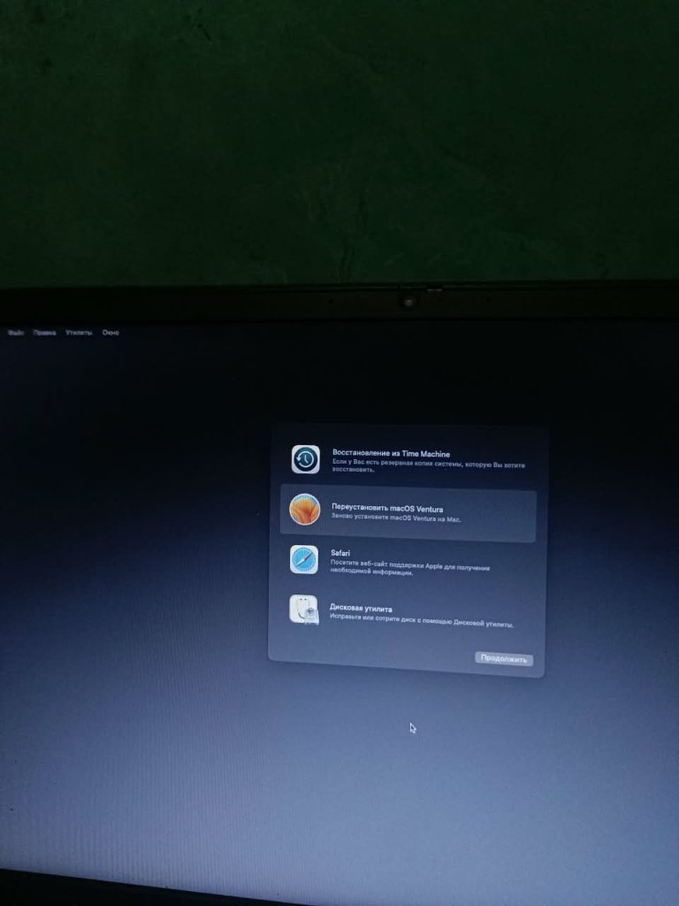

# Lenovo ThinkPad E14 Gen 2 (AMD) — OpenCore EFI

Working OpenCore configuration for running macOS Ventura on the Lenovo ThinkPad E14 Gen 2 (Type 20T9) powered by AMD Ryzen 5 4500U (Renoir).

---

## Hardware Specifications

| Component | Specification |
| :--- | :--- |
| **Model** | Lenovo ThinkPad E14 Gen 2 (Type 20T9) |
| **Processor** | AMD Ryzen 5 4500U (6 Cores / 6 Threads, Zen 2 Renoir) |
| **Graphics** | AMD Radeon Vega 6 (Integrated) |
| **Audio** | Realtek ALC257 |
| **Keyboard / Touchpad** | PS/2 Keyboard & TrackPoint / Synaptics Touchpad |
| **Bootloader** | OpenCore 1.0.8 |
| **Target OS** | macOS Ventura (13.x) |

---

## Hardware Functionality

- **CPU Power Management**: Working (`AMDRyzenCPUPowerManagement.kext` + `SMCAMDProcessor.kext`)
- **Graphics Acceleration**: Working with Metal support via `NootedRed.kext`
- **Keyboard & TouchPoint**: Working via `VoodooPS2Controller.kext`
- **Battery Status**: Working via `ECEnabler.kext` + `SMCBatteryManager.kext`
- **Display Brightness**: Working via `SSDT-PNLF.aml` + `BrightnessKeys.kext`
- **USB Ports**: Mapped via `SSDT-USBX.aml` & `SSDT-USB-Reset.aml`
- **Audio**: Working via `AppleALC.kext` (Layout ID 96 / 11)

---

## Technical Highlights: Solving `[EB|LOG:EXITBS:START]`

Many Ryzen 4000 series ThinkPads encounter an indefinite freeze at `[EB|LOG:EXITBS:START]` during boot. This configuration resolves the issue through the following parameters:

1. **Firmware Memory Map Handling**:
   - `EnableWriteUnprotector` = `True`
   - `RebuildAppleMemoryMap` = `False`
   - `SyncRuntimePermissions` = `False`
   - `SetupVirtualMap` = `True`
   *Reasoning:* Lenovo AMD firmware conflicts with OpenCore's runtime memory rebuild. Bypassing memory rebuilding allows the kernel to transition smoothly.

2. **AMD Vanilla Core Topology**:
   - `ProvideCurrentCpuInfo` = `True`
   *Reasoning:* Required by modern AMD Vanilla kernel patches to deliver proper core count and topology to macOS.

3. **Panic Mitigation**:
   - `AppleMCEReporterDisabler.kext` is injected to prevent instant panics triggered by macOS AppleMCEReporter on AMD processors.

4. **Embedded Controller**:
   - `SSDT-EC.aml` targets `\_SB.PCI0.LPC0.EC` matching the ThinkPad DSDT layout.

---

## How to Use

### 1. Configure Serial Numbers
For security, SMBIOS identifiers in `EFI/OC/config.plist` are left blank. Before booting:
1. Open `EFI/OC/config.plist` with OpenCore Auxiliary Tools or ProperTree.
2. Navigate to `PlatformInfo` -> `Generic`.
3. Set model to `MacBookPro16,3`.
4. Generate and fill:
   - `SystemSerialNumber`
   - `MLB`
   - `SystemUUID`

### 2. Recommended BIOS Settings
- **Disable**:
  - Secure Boot
  - Fast Boot
- **Enable**:
  - AMD V(TM) Technology / SVM
  - UEFI Only Boot Mode

### 3. Booting
1. Copy the `EFI` directory to your USB EFI partition.
2. Boot into the OpenCore menu.
3. Select **Reset NVRAM** once.
4. Select your macOS installer and proceed.

---

## Credits
- [Acidanthera](https://github.com/acidanthera) for OpenCore and core drivers.
- [ChefKissInc](https://github.com/ChefKissInc) for NootedRed.
- [AMD-OSX](https://github.com/AMD-OSX) community for kernel patch development.
